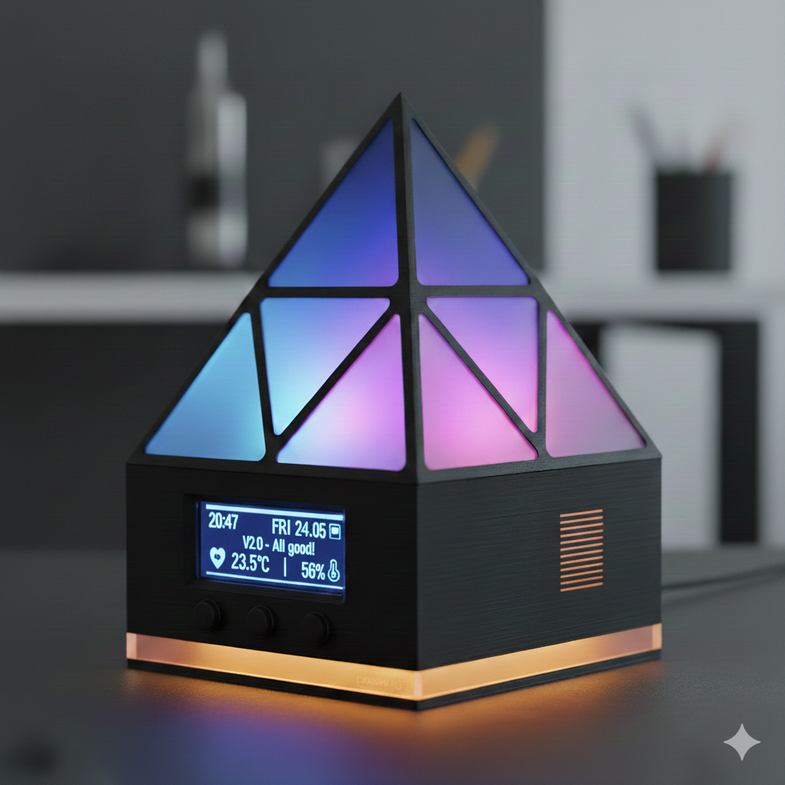

<p align="center">
  <a href="https://github.com/babeinlovexd"></a>
</p>

# Insane Moodlight OLED

[Fragen & Fehler](https://github.com/babeinlovexd/Insane-Moodlight-OLED/issues) · [Releases](https://github.com/babeinlovexd/Insane-Moodlight-OLED/releases)

Ein **ESP8266-Stimmungslicht mit OLED-Display**, LED-Effekten und eigenen Grußnachrichten. Das Projekt verbindet lokale Taster mit ESPHome und Home Assistant.

<p align="center"></p>

## Funktionen

- Haupt- und Sockelbeleuchtung mit Farben, Helligkeit und Effekten.
- Grußmodus mit Texten und animierten Symbolen auf dem OLED.
- Display-Pixel-Shift im Zwei-Minuten-Takt zur Verringerung statischer Bildbelastung.
- Gespeicherte Einstellungen und Master-Toggle für die Bedienung.
- DHT-Umweltdaten und geschätzter Akkuladestand aus der Spannung.
- Akkuwarnung im Fünf- bzw. Zehn-Sekunden-Takt bei niedrigen Werten, sofern kein Ladesignal anliegt.

## Hardware

Der Referenzaufbau nutzt einen **Wemos D1 Mini**, OLED, DHT-Sensor, drei Taster, einen SN74AHCT125N-Levelshifter und einen Akkuaufbau mit 18650-Zelle/TP4056. Die mechanische Basis ist mit 15 × 15 cm und einem 5-cm-Sockel beschrieben. Versorgung und Schutzbeschaltung müssen zum tatsächlichen Aufbau passen.

Die Gerber-Dateien liegen als [ZIP im Repository-Stamm](Gerber_insane-moodlight-oled_PCB_insane-moodlight-copy_2026-01-19.zip), nicht in einem separaten Gerber-Ordner. Pinbelegung und LED-Konfiguration stehen in [insane-moodlight-oled.yaml](insane-moodlight-oled.yaml).

## Installation

1. Die Haupt-YAML in den eigenen ESPHome-Konfigurationsordner kopieren.
2. Eigene Netzwerk-, API- und OTA-Daten in einer lokalen `secrets.yaml` hinterlegen:

```yaml
api_encryption_key: "DEIN_API_KEY"
ota_password: "DEIN_OTA_PASSWORT"
wifi_ssid: "DEIN_WLAN_NAME"
wifi_password: "DEIN_WLAN_PASSWORT"
ap_password: "DEIN_FALLBACK_PASSWORT"
```

3. Pins, Sensoren und LED-Anzahlen mit dem eigenen Aufbau abgleichen. Konfiguration in ESPHome prüfen und kompilieren.
4. Den Wemos D1 Mini zunächst per USB flashen, danach das Gerät über ESPHome in Home Assistant hinzufügen.
5. Taster, Beleuchtung und Display einzeln testen; anschließend die Gruß- und Akkuanzeige konfigurieren.

Verwende eigene Zugangsdaten und veröffentliche deine ausgefüllte `secrets.yaml` nicht.

## Bedienung & Kalibrierung

Der Master-Toggle schaltet den gespeicherten Lichtzustand. Der Grußmodus aktiviert die gewählte Nachricht und den Lichteffekt und kehrt anschließend zum vorherigen Zustand zurück. Texte, Dauer, Displayparameter und Sensor-Offsets werden über die bereitgestellten Home-Assistant-Entitäten eingestellt.

Der Akkuprozentsatz wird linear aus **3,2 bis 4,2 V** geschätzt. Er ersetzt keine gemessene Restkapazität. Bei höchstens 10 % warnt die Konfiguration alle zehn Sekunden, bei höchstens 5 % alle fünf Sekunden. Spannungsteiler und ADC-Kalibrierung müssen zum Board passen.

<p align="center">
  
  
  
</p>

## Fehlersuche

- **Flackernde LEDs:** Versorgung, gemeinsame Masse, Datenleitung und Levelshifter prüfen.
- **OLED bleibt leer:** I2C-Anschlüsse, Displayadresse und Konfiguration abgleichen.
- **Akkustand unplausibel:** Zunächst Rohspannung, Spannungsteiler und ADC prüfen.
- **Grußtext fehlt:** Text, Dauer und Grußmodus über Home Assistant prüfen; Pixel-Shift verhindert Einbrennen nicht garantiert.

*Entwickelt für Angelina.*

## Lizenz

[CC BY-NC-SA 4.0](https://creativecommons.org/licenses/by-nc-sa/4.0/). Es gilt die bestehende Projektlizenz. Drittanbieter-Komponenten behalten ihre jeweiligen Lizenzen.

---

## Builds und Releases

Version: **2.2.1** ([VERSION](VERSION)). [GitHub Actions](.github/workflows/release.yml) prüft Pushes und Pull Requests. Ein Tag passend zu `v` + `VERSION` veröffentlicht das Release erst nach erfolgreichen Jobs; manuelle Läufe liefern Build-Artefakte. [Downloads](https://github.com/babeinlovexd/Insane-Moodlight-OLED/releases).

ESPHome-CI verwendet Platzhalter-Zugangsdaten und flasht keine Geräte. Vor dem Einsatz eigene Secrets und Pinbelegung prüfen.

## Mitmachen

Fragen, Fehlerberichte und Beiträge sind willkommen. Nenne Version, Aufbau und Schritte zum Nachstellen im [Issue](https://github.com/babeinlovexd/Insane-Moodlight-OLED/issues). Größere Änderungen besprechen wir am besten vor einem Pull Request.

Dieses Hobbyprojekt unterstützen: [PayPal](https://www.paypal.me/babeinlovexd).

[BxD / BabeinlovexD](https://github.com/babeinlovexd) · [Website](https://babeinlovexd.de/)
